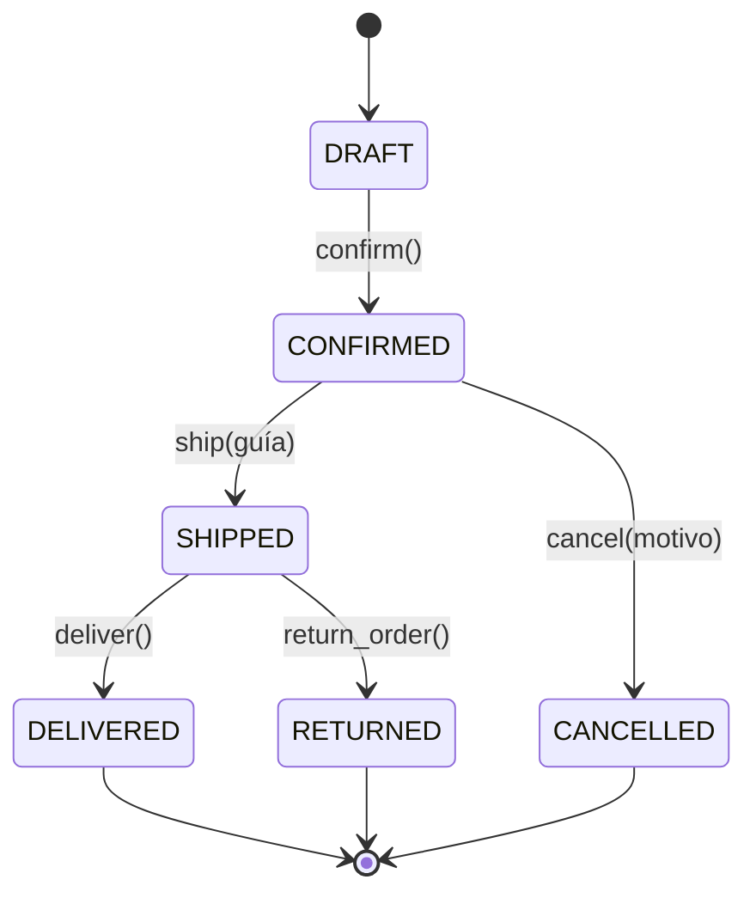

# Reporte · Actividad 4 · TechStore (DDD + FastAPI)

## 1. Diagrama de estados

`DELIVERED`, `CANCELLED` y `RETURNED` son estados finales: ninguna operación los modifica.

## 2. Domain Events

Un Domain Event es un hecho inmutable que ya ocurrió en el dominio. Cada uno guarda
`name`, `order_id` y `occurred_at` (UTC) y se agrega a `order.events` solo cuando la
transición se completó.

| Evento | Se emite en | Significado |
| --- | --- | --- |
| `OrderConfirmed` | `confirm()` | El pedido pasó de borrador a confirmado |
| `OrderShipped` | `ship()` | Salió con guía de envío |
| `OrderCancelled` | `cancel()` | Se canceló antes de enviarse |
| `OrderDelivered` | `deliver()` | Llegó al cliente |
| `OrderReturned` | `return_order()` | El cliente lo devolvió tras el envío |

Hoy los eventos solo se almacenan en la lista del agregado. Más adelante un manejador
podría reaccionar a ellos (correo, inventario, facturación) sin tocar la clase `Order`.

## 3. Preguntas del reporte

**¿Por qué se usa `Decimal` en lugar de `float` para precios?**
`float` representa números en binario y muchos decimales no tienen representación
exacta (`0.1 + 0.2` da `0.30000000000000004`). En dinero esos errores se acumulan y
rompen comparaciones exactas como la frontera `total > 500`. `Decimal` trabaja en base
10 con exactitud: `Decimal("600.00") * 2` es exactamente `1200.00`. Por eso `Money`
rechaza cualquier monto que no sea `Decimal`.

**¿Cuál es la diferencia entre contar renglones y sumar unidades?**
Un renglón es un `OrderItem` (un SKU con su cantidad); las unidades son la suma de
`quantity`. O001 tiene 2 renglones pero 4 unidades. El límite de 20 y la regla de
descuento de ≥ 4 se miden en unidades: O008 es un solo renglón con 20 unidades y es
válido, y O009 tiene 19 unidades en un solo renglón, así que agregar 2 más lo rechaza.
Contar renglones permitiría saltarse el límite con una sola línea de cantidad enorme.

**¿Qué ventaja tiene encapsular una regla en Specification?**
Cada condición queda con nombre, en una sola clase, probada de forma aislada y sin
efectos sobre el pedido. Las reglas de negocio se arman combinando con `&`, `|` y `~`,
de modo que `TEN_PERCENT_SPEC` se lee casi como el enunciado. Si cambia un umbral solo
se edita un lugar, y las mismas especificaciones sirven para descuentos, reportes o
validaciones sin duplicar `if` por todo el código.

**¿Por qué los eventos se registran solo después de una transición válida?**
Un evento afirma que algo ya sucedió. Si se registrara antes de validar, un intento
rechazado dejaría un `OrderShipped` falso y cualquier consumidor del evento (correo,
inventario) actuaría sobre un hecho inexistente. Validar, cambiar estado y registrar al
final deja la historia del pedido consistente con su estado: en E12 la segunda
confirmación falla y `events` sigue con un solo `OrderConfirmed`.

**¿Qué parte del código podrías reutilizar si reemplazas FastAPI por otra interfaz?**
Todo `app/domain.py` y `app/specifications.py`, además de `cargar_csv.py`. No importan
FastAPI ni HTTP, así que una CLI, una interfaz gráfica o gRPC podrían usarlos
tal cual. Solo cambia la capa de entrada: `api.py` se limita a buscar el pedido,
llamar al método de `Order` y traducir excepciones a códigos HTTP.

## 4. Reflexión: tres errores encontrados y aprendizajes

> Sección personal: completa con los errores que realmente encontró el equipo.

1. **Error:** _______ · **Cómo se solucionó:** _______
2. **Error:** _______ · **Cómo se solucionó:** _______
3. **Error:** _______ · **Cómo se solucionó:** _______

**Qué aprendimos:** _______
