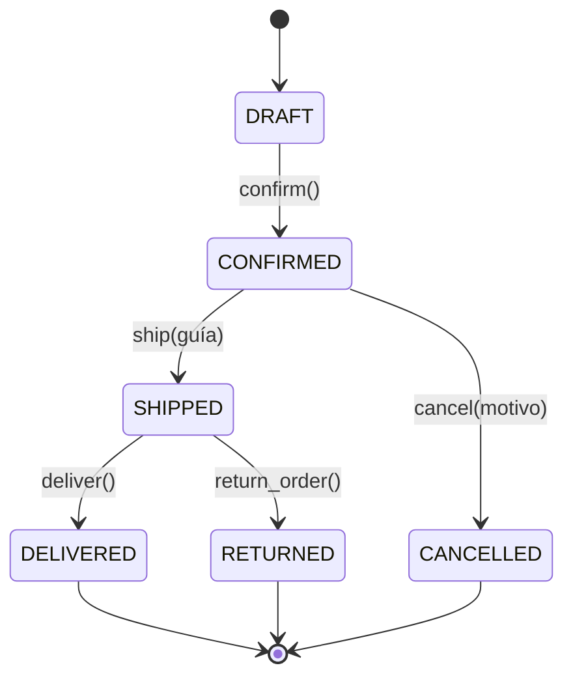

## 1. Diagrama de estados

`DELIVERED`, `CANCELLED` y `RETURNED` son estados finales: ninguna operación los modifica.

## 2. Domain Events

Un Domain Event es un hecho inmutable que ya ocurrió en el dominio. Cada uno guarda
`name`, `order_id` y `occurred_at` (UTC) y se agrega a `order.events` solo cuando la
transición se completó.

| Evento           | Se emite en      | Significado                             |
| ---------------- | ---------------- | --------------------------------------- |
| `OrderConfirmed` | `confirm()`      | El pedido pasó de borrador a confirmado |
| `OrderShipped`   | `ship()`         | Salió con guía de envío                 |
| `OrderCancelled` | `cancel()`       | Se canceló antes de enviarse            |
| `OrderDelivered` | `deliver()`      | Llegó al cliente                        |
| `OrderReturned`  | `return_order()` | El cliente lo devolvió tras el envío    |

Los eventos solo se almacenan en la lista del agregado. Más adelante un manejador
podría reaccionar a ellos (correo, inventario, facturación) sin tocar la clase `Order`.
